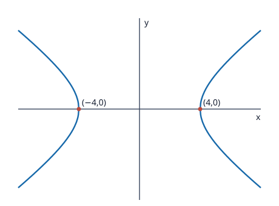

# Problem 05: Hyperbola and Asymptotes

## 1. Original Problem
For
$$\frac{x^2}{16}-\frac{y^2}{9}=1,$$
find the intercepts with the $x$-axis, the asymptotes, and make a sketch. Explain why the asymptotes describe the behavior of the curve far from the center.

## 2. What We Are Trying to Find
We must calculate the $x$-axis intercepts of the canonical hyperbola, find the equations of its two asymptotes, describe the visual shape of the two branches, and explain analytically why the curve approaches its asymptotes arbitrarily closely as $|x| \to \infty$.

## 3. Key Idea or Theorem Needed Before the Calculation
- **Canonical Hyperbola**:
  $$\frac{x^2}{a^2} - \frac{y^2}{b^2} = 1.$$
  - Vertices ($x$-intercepts): $(\pm a, 0)$.
  - $y$-intercepts: None (setting $x = 0$ gives $-y^2/b^2 = 1 \implies y^2 = -b^2$, which has no real solutions).
  - **Asymptotes**: The lines obtained by setting the right-hand constant to $0$:
    $$\frac{x^2}{a^2} - \frac{y^2}{b^2} = 0 \iff y = \pm \frac{b}{a} x.$$
- **Asymptotic Behavior Far from Center**: For very large $|x|$, the constant $1$ becomes negligible relative to $x^2/a^2$, so the hyperbola approaches the lines $y = \pm \frac{b}{a} x$.

## 4. Step-by-Step Solution

### Step 1: Identify Parameters $a$ and $b$
From $\frac{x^2}{16} - \frac{y^2}{9} = 1$:
- $a^2 = 16 \implies a = 4$.
- $b^2 = 9 \implies b = 3$.

### Step 2: Find the $x$-Axis Intercepts (Vertices)
Set $y = 0$:
$$\frac{x^2}{16} - 0 = 1 \implies x^2 = 16 \implies x = \pm 4.$$
The hyperbola intersects the $x$-axis at the two vertices:
$$V_1 = (-4, 0) \quad \text{and} \quad V_2 = (4, 0).$$

### Step 3: Find the Equations of the Asymptotes
Replace $1$ with $0$ in the canonical equation:
$$\frac{x^2}{16} - \frac{y^2}{9} = 0 \implies \frac{y^2}{9} = \frac{x^2}{16} \implies y^2 = \frac{9}{16} x^2.$$
Taking square roots gives the two linear asymptote equations:
$$y = \pm \frac{3}{4} x.$$

### Step 4: Explain Why Asymptotes Describe the Curve Far from Center
Solve the hyperbola equation explicitly for $y$:
$$\frac{y^2}{9} = \frac{x^2}{16} - 1 \implies y^2 = \frac{9}{16} x^2 \left(1 - \frac{16}{x^2}\right).$$
Taking the square root for $x > 0$:
$$y = \pm \frac{3}{4} x \sqrt{1 - \frac{16}{x^2}}.$$
Now analyze the behavior as $x \to \infty$:
- As $x$ becomes very large ($x \to \infty$), the term $\frac{16}{x^2} \to 0$.
- Therefore, $\sqrt{1 - \frac{16}{x^2}} \to \sqrt{1 - 0} = 1$.
- This means:
  $$y \approx \pm \frac{3}{4} x.$$
More precisely, compute the difference between the hyperbola and the asymptote line:
$$\frac{3}{4} x - \frac{3}{4} x \sqrt{1 - \frac{16}{x^2}} = \frac{3}{4} x \left(1 - \sqrt{1 - \frac{16}{x^2}}\right) = \frac{3}{4} x \cdot \frac{\frac{16}{x^2}}{1 + \sqrt{1 - \frac{16}{x^2}}} = \frac{12}{x \left(1 + \sqrt{1 - \frac{16}{x^2}}\right)} \xrightarrow{x \to \infty} 0.$$
The vertical distance between the curve and the asymptote lines vanishes to zero as $|x| \to \infty$. Near the center, the constant 1 creates the gap of size $2a = 8$ between vertices, but far away, that constant 1 is negligible compared to huge $x^2$, making the hyperbola indistinguishable from its asymptotes.

### Sketch

The vertices are $(\pm4,0)$; the dashed lines are the asymptotes $y=\pm3x/4$.

## 5. Why Each Step Is Valid
- Factoring out $x^2$ isolates the asymptotic dominant term in the function.
- The limit evaluation proves convergence of the curve to the asymptotes at infinity.

## 6. Final Answer in Words
The hyperbola intersects the $x$-axis at the vertices $(-4, 0)$ and $(4, 0)$. Its two asymptotes are the lines $y = \frac{3}{4}x$ and $y = -\frac{3}{4}x$. The asymptotes describe the behavior of the curve far from the center because as $|x| \to \infty$, the constant $1$ in the equation becomes negligible compared to $x^2/16$, causing the vertical distance between the hyperbola and the lines to approach zero.

## 7. Quick Verification
- Test $x = 20$:
  Asymptote value: $y_{\text{asymp}} = \frac{3}{4}(20) = 15$.
  Hyperbola value: $y_{\text{hyp}} = 3 \sqrt{\frac{400}{16} - 1} = 3 \sqrt{25 - 1} = 3 \sqrt{24} \approx 3(4.89898) = 14.697$.
  The difference is only $15 - 14.697 = 0.303$.
- For $x = 100$: $y_{\text{asymp}} = 75$, $y_{\text{hyp}} = 3 \sqrt{624} \approx 74.94$. Difference is $0.06$.
  The curve clearly approaches the line as $x$ increases.

## 8. Common Mistakes
- Claiming the hyperbola has $y$-intercepts at $(0, \pm 3)$ (confusing the hyperbola with an ellipse; $y$-intercepts are imaginary).
- Swapping the slope of the asymptotes to $\pm \frac{4}{3}x$ instead of $\pm \frac{b}{a}x = \pm \frac{3}{4}x$.

## 9. Short In-Class Explanation (3 Sentences)
Setting $y = 0$ gives $x^2 = 16$, which identifies the vertices and $x$-intercepts at $(\pm 4, 0)$. Replacing the constant 1 with 0 produces the asymptote lines $y = \pm \frac{3}{4}x$. As $|x|$ becomes very large, the constant 1 becomes negligible relative to $x^2$, so the hyperbola gets closer and closer to these two straight lines.
