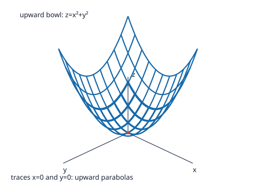
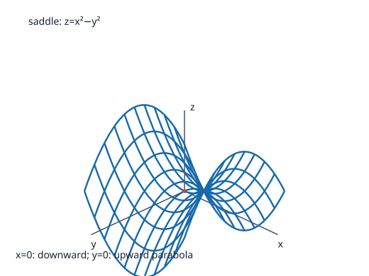

# Problem 10: Paraboloids

## 1. Original Problem
Compare
$$z=x^2+y^2$$
and
$$z=x^2-y^2.$$
For each surface, describe the cross-sections $x=0$, $y=0$, and $z=c$, then make a qualitative sketch.

## 2. What We Are Trying to Find
We need to compare two fundamental quadric surfaces:
1. The circular/elliptic paraboloid $z = x^2 + y^2$.
2. The hyperbolic paraboloid $z = x^2 - y^2$.

For each surface, we must find and describe the cross-sections by:
- The coordinate plane $x = 0$ ($yz$-plane).
- The coordinate plane $y = 0$ ($xz$-plane).
- The family of horizontal planes $z = c$ for various values of $c$.
Finally, we must describe their qualitative geometric shapes.

## 3. Key Idea or Theorem Needed Before the Calculation
- **Method of Slices (Cross-Sections)**:
  Analyzing a 3D surface $z = f(x, y)$ by setting one variable to a constant reduces the study to familiar 2D plane curves:
  - Vertical slices ($x = \text{const}$ or $y = \text{const}$) reveal profiles along coordinate planes.
  - Horizontal slices ($z = c$) act as level curves (contour lines).
- **Paraboloid Types**:
  - If both principal curvatures have the same sign (e.g., $z = x^2 + y^2$), the surface is an **elliptic paraboloid** (bowl-shaped).
  - If the principal curvatures have opposite signs (e.g., $z = x^2 - y^2$), the surface is a **hyperbolic paraboloid** (saddle-shaped).

## 4. Step-by-Step Solution

### Surface 1: $z = x^2 + y^2$ (Elliptic / Circular Paraboloid)

#### 1. Vertical cross-section $x = 0$:
- Setting $x = 0$ gives $z = y^2$.
- This is a standard **parabola** in the $yz$-plane with vertex at the origin $(0, 0, 0)$ opening upward along the $+z$ axis.

#### 2. Vertical cross-section $y = 0$:
- Setting $y = 0$ gives $z = x^2$.
- This is a standard **parabola** in the $xz$-plane with vertex at $(0, 0, 0)$ opening upward along the $+z$ axis.

#### 3. Horizontal cross-sections $z = c$:
- Substitute $z = c$ into $z = x^2 + y^2$, yielding $x^2 + y^2 = c$.
  - **If $c > 0$**: The cross-section is a **circle** centered at $(0, 0, c)$ with radius $R = \sqrt{c}$. As $c$ increases, the radius grows proportionally to $\sqrt{c}$.
  - **If $c = 0$**: $x^2 + y^2 = 0$, which is a **single point** $(0, 0, 0)$ (the global minimum vertex).
  - **If $c < 0$**: $x^2 + y^2 = c < 0$ has no real solutions; there are **no points** below the $xy$-plane.

#### 4. Qualitative Shape:
- A smooth, cup- or bowl-shaped rotational surface opening upward from its lowest point at the origin.

---

### Surface 2: $z = x^2 - y^2$ (Hyperbolic Paraboloid)

#### 1. Vertical cross-section $x = 0$:
- Setting $x = 0$ gives $z = -y^2$.
- This is a **parabola** in the $yz$-plane with vertex at the origin $(0, 0, 0)$ opening **downward** along the $-z$ axis.

#### 2. Vertical cross-section $y = 0$:
- Setting $y = 0$ gives $z = x^2$.
- This is a **parabola** in the $xz$-plane with vertex at the origin $(0, 0, 0)$ opening **upward** along the $+z$ axis.

#### 3. Horizontal cross-sections $z = c$:
- Substitute $z = c$ into $z = x^2 - y^2$, yielding $x^2 - y^2 = c$.
  - **If $c > 0$**: This is a **hyperbola** with vertices at $(\pm \sqrt{c}, 0, c)$, opening along the $x$-direction (left and right).
  - **If $c = 0$**: $x^2 - y^2 = 0 \implies (x - y)(x + y) = 0$, which is a pair of **intersecting straight lines** $y = x$ and $y = -x$ passing through the origin.
  - **If $c < 0$**: Rearranging gives $y^2 - x^2 = -c = |c| > 0$. This is a **hyperbola** with vertices at $(0, \pm \sqrt{|c|}, c)$, opening along the $y$-direction (front and back).

#### 4. Qualitative Shape:
- A classic **saddle surface** (or mountain pass / potato chip). At the origin $(0, 0, 0)$, moving along the $x$-axis leads uphill, while moving along the $y$-axis leads downhill. The origin is a saddle point.

### Qualitative sketches

The coordinate axes are labelled, and the wireframes show representative traces in the coordinate directions: upward parabolas in both directions for the bowl, and an upward and downward trace for the saddle.

## 5. Why Each Step Is Valid
1. **Vertical slices**: Holding one variable constant effectively confines the geometry to a two-dimensional plane, where the quadratic dependency immediately yields standard parabolas.
2. **Horizontal contour analysis**: For $z = c$, the sign of the constant determines whether quadratic forms define circles, hyperbolas, degenerate lines, or empty sets.
3. **Contrasting curvature**: In $z = x^2 + y^2$, both quadratic coefficients are positive ($+1, +1$), forcing curves in both directions to bend upward together. In $z = x^2 - y^2$, the coefficients have opposite signs ($+1, -1$), causing one vertical slice to curve up while the other curves down.

## 6. Final Answer in Words
For $z=x^2+y^2$, both vertical slices $x=0$ and $y=0$ are upward-opening parabolas $z=y^2$ and $z=x^2$, and horizontal slices $z=c$ are concentric circles of radius $\sqrt{c}$ for $c>0$, producing a bowl-shaped elliptic paraboloid. For $z=x^2-y^2$, the vertical slice $y=0$ is an upward parabola $z=x^2$ while $x=0$ is a downward parabola $z=-y^2$, and horizontal slices are hyperbolas opening in the $x$-direction for $c>0$, a pair of intersecting lines for $c=0$, and hyperbolas opening in the $y$-direction for $c<0$, producing a saddle surface.

## 7. Quick Verification
- For $z = x^2 + y^2$: at $(1, 1)$, $z = 1 + 1 = 2 > 0$. At $(-1, 1)$, $z = 2 > 0$. The surface strictly stays on or above $z = 0$.
- For $z = x^2 - y^2$: at $(2, 0)$, $z = 4 > 0$ (uphill). At $(0, 2)$, $z = -4 < 0$ (downhill). At $(2, 2)$, $z = 4 - 4 = 0$ (lying on the asymptotic line $y=x$).

## 8. Common Mistakes
- **Confusing the two surfaces**: Calling $z = x^2 - y^2$ a paraboloid without specifying that it is a *hyperbolic* paraboloid (a saddle).
- **Overlooking negative $z$ for the hyperbolic paraboloid**: Thinking that $z$ cannot be negative in $z = x^2 - y^2$, when in fact $z < 0$ whenever $|y| > |x|$.
- **Missing the degenerate slice at $z = 0$ for the saddle**: Forgetting that $x^2 - y^2 = 0$ represents two intersecting straight lines ($y = \pm x$), not a single point.

## 9. Short In-Class Explanation (3 Sentences)
The surface $z=x^2+y^2$ has upward-curving parabolas in both coordinate planes and circular horizontal cross-sections, forming an upward-opening bowl. In contrast, $z=x^2-y^2$ curves upward along the $x$-axis but downward along the $y$-axis, while its horizontal cross-sections are hyperbolas that switch orientation across $z=0$. This creates a classic saddle surface with a saddle point at the origin instead of an extremum.
