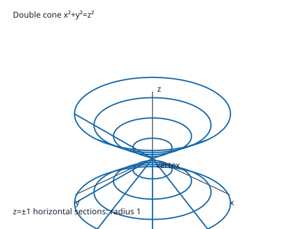
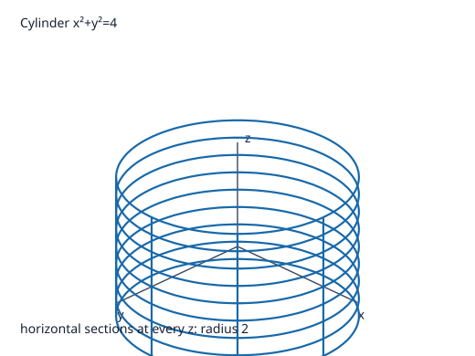

# Problem 14: Cone and Cylinder

## 1. Original Problem
Compare
$$x^2+y^2=z^2$$
and
$$x^2+y^2=4.$$
For each surface, describe the cross-sections $z=c$, $x=0$, and $y=0$, make a sketch, and explain why the radius of the cross-section depends on $z$ in the first case but is constant in the second.

## 2. What We Are Trying to Find
We need to compare two classic quadric surfaces:
1. $x^2 + y^2 = z^2$ (a circular double cone).
2. $x^2 + y^2 = 4$ (a circular cylinder).

For each surface, we must:
- Describe the horizontal cross-sections $z = c$.
- Describe the vertical cross-sections by the coordinate planes $x = 0$ ($yz$-plane) and $y = 0$ ($xz$-plane).
- Provide a qualitative sketch description.
- Explain the algebraic and geometric reason why the horizontal cross-sectional radius varies with $z$ in the cone but remains strictly constant in the cylinder.

## 3. Key Idea or Theorem Needed Before the Calculation
- **Role of Missing Variables**:
  If a variable (such as $z$) is completely absent from a 3D equation $F(x, y) = 0$, the surface is a **cylinder** whose generating curve $F(x, y) = 0$ is translated parallel to the missing coordinate axis. Its cross-sections perpendicular to that axis are identical copies.
- **Explicit Height Dependence**:
  When the equation relates the horizontal radial distance $r = \sqrt{x^2+y^2}$ directly to $z$, the horizontal cross-sections are scaled as a function of the height $z$. For $r^2 = z^2$, the radius $r = |z|$ expands linearly away from the vertex $z = 0$.

## 4. Step-by-Step Solution

### Surface 1: $x^2 + y^2 = z^2$ (Circular Double Cone)

#### 1. Horizontal cross-sections $z = c$:
- Substitute $z = c$ into the equation:
  $$x^2 + y^2 = c^2.$$
  - **For $c \neq 0$**: This is a **circle** in the plane $z = c$ centered at $(0, 0, c)$ with radius $R(c) = |c|$.
  - **For $c = 0$**: $x^2 + y^2 = 0 \implies (0, 0, 0)$, a **single point** (the cone vertex / apex).
- As $|c|$ increases, the radius grows linearly ($R = |c|$).

#### 2. Vertical cross-section $x = 0$ ($yz$-plane):
- Set $x = 0$:
  $$y^2 = z^2 \implies z^2 - y^2 = 0 \implies (z - y)(z + y) = 0.$$
- This is a pair of **intersecting straight lines** passing through the origin:
  $$z = y \quad \text{and} \quad z = -y.$$

#### 3. Vertical cross-section $y = 0$ ($xz$-plane):
- Set $y = 0$:
  $$x^2 = z^2 \implies z^2 - x^2 = 0 \implies (z - x)(z + x) = 0.$$
- This is a pair of **intersecting straight lines** passing through the origin:
  $$z = x \quad \text{and} \quad z = -x.$$

#### 4. Qualitative Shape:
- Two symmetric conical funnels joined at their tips at the origin $(0, 0, 0)$, opening outward indefinitely toward $+z$ and $-z$.

---

### Surface 2: $x^2 + y^2 = 4$ (Circular Cylinder)

#### 1. Horizontal cross-sections $z = c$:
- For any arbitrary value of $c \in (-\infty, \infty)$, the relation in the plane $z = c$ is:
  $$x^2 + y^2 = 4 = 2^2.$$
- This is a **circle** centered at $(0, 0, c)$ with radius $R = 2$, completely independent of $c$.

#### 2. Vertical cross-section $x = 0$ ($yz$-plane):
- Set $x = 0$:
  $$y^2 = 4 \implies y = 2 \quad \text{or} \quad y = -2.$$
- In 3D space, these are two **parallel vertical lines** running parallel to the $z$-axis at $y = \pm 2$.

#### 3. Vertical cross-section $y = 0$ ($xz$-plane):
- Set $y = 0$:
  $$x^2 = 4 \implies x = 2 \quad \text{or} \quad x = -2.$$
- These are two **parallel vertical lines** running parallel to the $z$-axis at $x = \pm 2$.

#### 4. Qualitative Shape:
- A straight, infinitely long hollow pipe or tube of uniform radius $2$ centered along the vertical $z$-axis.

---

### Step 5: Why does the radius depend on $z$ in the cone but not in the cylinder?
- **Algebraic explanation**:
  In the equation of the cone $x^2 + y^2 = z^2$, the variable $z$ is explicitly present. Setting $z = c$ fixes the sum of squares to $c^2$, making the radius $R = \sqrt{c^2} = |c|$ a direct function of the chosen height $c$.
  In the equation of the cylinder $x^2 + y^2 = 4$, the variable $z$ is completely missing. Setting $z = c$ does not affect the equation at all: for any value of $z$, the coordinates $(x, y)$ must always satisfy $x^2 + y^2 = 4$.
- **Geometric explanation**:
  The cone is generated by rotating lines that pass through the origin and slant at a $45^\circ$ angle relative to the $z$-axis. As you move along $z$, the distance from the ruling lines to the axis changes proportionally.
  The cylinder is generated by translating a circle of radius $2$ straight along lines parallel to the $z$-axis. Because the generating lines are vertical, the distance to the axis is identical at every elevation.

### Qualitative sketches

The cone has a vertex at the origin and opens in both $+z$ and $-z$ directions. The cylinder has constant radius $2$ at every height. Both diagrams label the axes and show representative horizontal sections.

## 5. Why Each Step Is Valid
1. **Planar slicing**: Setting a coordinate to a constant isolates the 2D geometry within that coordinate plane.
2. **Factoring differences of squares**: The equation $u^2 = v^2$ factors into $(u - v)(u + v) = 0$, which is the union of two distinct intersecting lines $u = v$ and $u = -v$.
3. **Absence of coordinates in cylindrical surfaces**: Any equation in $\mathbb{R}^3$ lacking one variable $z$ defines a surface consisting of vertical lines through the 2D curve in the remaining variables, ensuring invariant cross-sections across all heights.

## 6. Final Answer in Words
For the cone $x^2+y^2=z^2$, horizontal cross-sections are circles of variable radius $R=|c|$ (shrinking to a point at $z=0$), and vertical cross-sections through coordinate planes are pairs of intersecting straight lines $z=\pm y$ and $z=\pm x$. For the cylinder $x^2+y^2=4$, horizontal cross-sections are always identical circles of constant radius $2$, and vertical cross-sections are pairs of parallel vertical lines $y=\pm 2$ and $x=\pm 2$. The radius depends on $z$ in the cone because $z$ appears explicitly on the right side, whereas in the cylinder $z$ is completely absent, meaning height imposes no constraint on the circle's radius.

## 7. Quick Verification
- At $z = 10$: cone has radius $R = 10$, while cylinder has radius $R = 2$.
- At $z = 0$: cone has radius $R = 0$ (vertex), while cylinder still has radius $R = 2$.
- At $z = -3$: cone has radius $R = |-3| = 3$, cylinder has radius $R = 2$.
Every calculation matches the structural properties derived.

## 8. Common Mistakes
- **Writing $R = c$ instead of $R = |c|$**: A radius cannot be negative; when $z = -3$, the radius is $+3$, not $-3$.
- **Thinking the vertical cross-sections of a cone are parabolas**: Confusing the cone $z^2 = x^2+y^2$ with the paraboloid $z = x^2+y^2$. In a cone, $x=0$ yields lines $z = \pm y$, not parabolas.
- **Describing the cylinder cross-sections $x=0$ as points**: In 3D space, $y = \pm 2$ in the plane $x = 0$ represents two infinite vertical lines, not just two isolated points.

## 9. Short In-Class Explanation (3 Sentences)
Horizontal cross-sections of $x^2+y^2=z^2$ are circles whose radius $|z|$ expands linearly away from the origin, while vertical cross-sections are intersecting lines forming a double cone. For $x^2+y^2=4$, the variable $z$ is absent, so every horizontal cross-section is the exact same circle of radius $2$, forming a straight vertical cylinder. The cone varies with height because $z$ is part of the equation, whereas the cylinder is uniform because $z$ is completely unconstrained.
