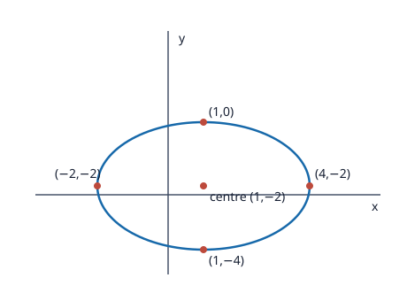
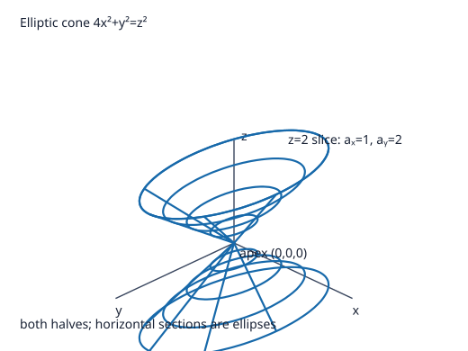

# Problem 15: Recognition and Sketch Without a Given Name

## 1. Original Problem
Consider the two equations:

$$4x^2+9y^2-8x+36y+4=0,$$

$$4x^2+y^2=z^2.$$

For the first equation, reduce it to canonical form, recognize the curve, give its most important features, and make a sketch.

For the second equation, do not begin by using a ready-made name for the surface. First describe the cross-sections $z=c$ and the cross-sections by the planes $x=0$ and $y=0$, paying attention to the different scales along the axes. Only then identify the surface and make a sketch.

## 2. What We Are Trying to Find
We must analyze two quadratic equations without prematurely jumping to conclusions:
1. For $4x^2 + 9y^2 - 8x + 36y + 4 = 0$: Complete the square to bring it to canonical form, identify the 2D curve, and determine its center, semiaxes, and vertices.
2. For $4x^2 + y^2 = z^2$: Systematically slice the 3D surface with horizontal planes $z = c$ and coordinate planes $x = 0$ and $y = 0$, note the unequal axis scaling, identify the resulting geometric object, and describe its 3D form.

## 3. Key Idea or Theorem Needed Before the Calculation
- **Canonical Form of a Conic**:
  Completing the square on $A(x - x_0)^2 + B(y - y_0)^2 = C$ reveals whether the curve is an ellipse, hyperbola, or degenerate conic.
- **Cross-Section Analysis for Quadric Surfaces**:
  Determining the family of curves formed by intersections with $z = c$, $x = 0$, and $y = 0$ allows us to deduce the 3D geometry from first principles without memorizing surface names.

## 4. Step-by-Step Solution

---

### Part 1: Analyzing $4x^2 + 9y^2 - 8x + 36y + 4 = 0$

#### Step 1: Group terms by variable
$$(4x^2 - 8x) + (9y^2 + 36y) = -4.$$
Factor out the leading coefficients:
$$4(x^2 - 2x) + 9(y^2 + 4y) = -4.$$

#### Step 2: Complete the square
- $x^2 - 2x = (x - 1)^2 - 1$.
- $y^2 + 4y = (y + 2)^2 - 4$.

Substitute back:
$$4\left[(x - 1)^2 - 1\right] + 9\left[(y + 2)^2 - 4\right] = -4.$$
Distribute the factors:
$$4(x - 1)^2 - 4 + 9(y + 2)^2 - 36 = -4.$$
Combine constants on the left:
$$4(x - 1)^2 + 9(y + 2)^2 - 40 = -4.$$
Add $40$ to both sides:
$$4(x - 1)^2 + 9(y + 2)^2 = 36.$$

#### Step 3: Divide by 36 to obtain canonical form
$$\frac{4(x - 1)^2}{36} + \frac{9(y + 2)^2}{36} = 1 \implies \frac{(x - 1)^2}{9} + \frac{(y + 2)^2}{4} = 1.$$
Writing denominators as squares:
$$\frac{(x - 1)^2}{3^2} + \frac{(y + 2)^2}{2^2} = 1.$$

#### Step 4: Extract key features
- **Curve Type**: **Ellipse** (both variables squared with positive, unequal denominators).
- **Center**: $(x_0, y_0) = (1, -2)$.
- **Horizontal semi-major axis**: $a = 3$.
- **Vertical semi-minor axis**: $b = 2$.
- **Vertices**:
  - Horizontal vertices: $(1 \pm 3, -2) \implies (4, -2)$ and $(-2, -2)$.
  - Vertical vertices: $(1, -2 \pm 2) \implies (1, 0)$ and $(1, -4)$.
- **Sketch description**: A smooth oval centered at $(1, -2)$, wider horizontally (total width $6$) than vertically (total height $4$).

---

### Part 2: Analyzing $4x^2 + y^2 = z^2$ from Cross-Sections

#### Step 1: Analyze horizontal cross-sections $z = c$
Substitute $z = c$:
$$4x^2 + y^2 = c^2.$$
- **If $c = 0$**:
  $$4x^2 + y^2 = 0 \implies x = 0, y = 0.$$
  The cross-section is the **single point** $(0, 0, 0)$.
- **If $c \neq 0$**:
  Divide both sides by $c^2$:
  $$\frac{4x^2}{c^2} + \frac{y^2}{c^2} = 1 \implies \frac{x^2}{(|c|/2)^2} + \frac{y^2}{|c|^2} = 1.$$
  This is an **ellipse** in the plane $z = c$ centered at $(0, 0, c)$ with:
  - Semiaxis along $x$: $a(c) = \frac{|c|}{2}$.
  - Semiaxis along $y$: $b(c) = |c|$.
  - **Scale observation**: The semiaxis along $y$ is exactly twice as long as the semiaxis along $x$ ($b(c) = 2 a(c)$). The cross-sections are ellipses stretched along the $y$-axis. As $|c|$ grows, these ellipses expand proportionally to $|c|$.

#### Step 2: Analyze vertical cross-section $x = 0$ ($yz$-plane)
Set $x = 0$ in $4x^2 + y^2 = z^2$:
$$y^2 = z^2 \implies z^2 - y^2 = 0 \implies (z - y)(z + y) = 0.$$
- This gives two **intersecting straight lines** through the origin:
  $$z = y \quad \text{and} \quad z = -y.$$
- Their slopes are $\pm 1$ ($45^\circ$ angle with the $y$-axis).

#### Step 3: Analyze vertical cross-section $y = 0$ ($xz$-plane)
Set $y = 0$ in $4x^2 + y^2 = z^2$:
$$4x^2 = z^2 \implies z^2 - 4x^2 = 0 \implies (z - 2x)(z + 2x) = 0.$$
- This gives two **intersecting straight lines** through the origin:
  $$z = 2x \quad \text{and} \quad z = -2x.$$
- Their slopes are $\pm 2$, which are twice as steep as the lines in the $yz$-plane.

#### Step 4: Identify the surface and describe the 3D sketch
- **Identification**: Because all horizontal slices are ellipses expanding linearly with height, and all vertical slices through the origin are straight lines, the surface is an **elliptic cone**.
- **Features**:
  - Vertex (apex): $(0, 0, 0)$.
  - Axis of symmetry: the $z$-axis.
  - Geometry: It consists of two symmetric funnels meeting at the origin, flattened in the $x$-direction and stretched twice as wide along the $y$-direction.

### Sketches

The ellipse sketch labels its centre and four vertices. The cone sketch shows both halves, the apex, and a horizontal elliptical section whose $y$-semiaxis is twice its $x$-semiaxis.

## 5. Why Each Step Is Valid
1. **Completing the square**: Reorganizing quadratic and linear terms into binomial squares preserves equality while uncovering the translation vector $(1, -2)$.
2. **Dividing by $c^2$**: For any non-zero elevation $c$, dividing by $c^2 > 0$ converts $4x^2 + y^2 = c^2$ into the canonical 2D ellipse equation.
3. **Linear generators**: Setting $x=0$ and $y=0$ shows that the surface contains straight lines passing through the origin, which is the defining geometric property of a conical surface.

## 6. Final Answer in Words
The first equation reduces to $\frac{(x-1)^2}{9} + \frac{(y+2)^2}{4} = 1$, which is an ellipse centered at $(1, -2)$ with horizontal semiaxis $3$ and vertical semiaxis $2$. For the second equation, horizontal slices $z=c$ are ellipses $\frac{x^2}{(|c|/2)^2} + \frac{y^2}{|c|^2} = 1$ with the $y$-axis twice as wide as the $x$-axis, while the vertical slices $x=0$ and $y=0$ are pairs of intersecting straight lines $z=\pm y$ and $z=\pm 2x$. Together, these cross-sections establish that the second surface is an **elliptic cone** with vertex at the origin opening along the $z$-axis.

## 7. Quick Verification
- For the ellipse: Check vertex $(4, -2)$:
  $$4(16) + 9(4) - 8(4) + 36(-2) + 4 = 64 + 36 - 32 - 72 + 4 = 104 - 104 = 0.$$
  The vertex lies on the curve.
- For the cone: At $z = 2$, the horizontal slice is $4x^2 + y^2 = 4 \implies x^2 + \frac{y^2}{4} = 1$, an ellipse with semiaxes $a = 1$ and $b = 2$, perfectly matching $a = |2|/2 = 1$ and $b = 2$.
- Point $(1, 0, 2)$ gives $4(1) + 0 = 4 = 2^2$, confirming the point lies on the cone.

## 8. Common Mistakes
- **Assuming the cone is circular**: Ignoring the factor of $4$ in front of $x^2$, which causes the horizontal slices to be distinctly elliptical rather than circular.
- **Confusing slopes in cross-sections**: Thinking $4x^2 = z^2$ gives $z = \pm 4x$ instead of taking the square root to get $z = \pm 2x$.
- **Arithmetic slips in completing the square**: Adding $4$ and $36$ without carefully tracking signs when balancing on the right-hand side.

## 9. Short In-Class Explanation (3 Sentences)
Completing the square in the first equation yields $\frac{(x-1)^2}{9} + \frac{(y+2)^2}{4} = 1$, identifying an ellipse centered at $(1, -2)$ with semiaxes $3$ and $2$. For the second equation, horizontal cross-sections are ellipses whose $y$-semiaxis is twice as large as their $x$-semiaxis, expanding linearly as $|z|$ increases from the origin. Since the vertical cross-sections are intersecting lines of slopes $\pm 1$ and $\pm 2$, the surface is an elliptic cone oriented along the $z$-axis.
