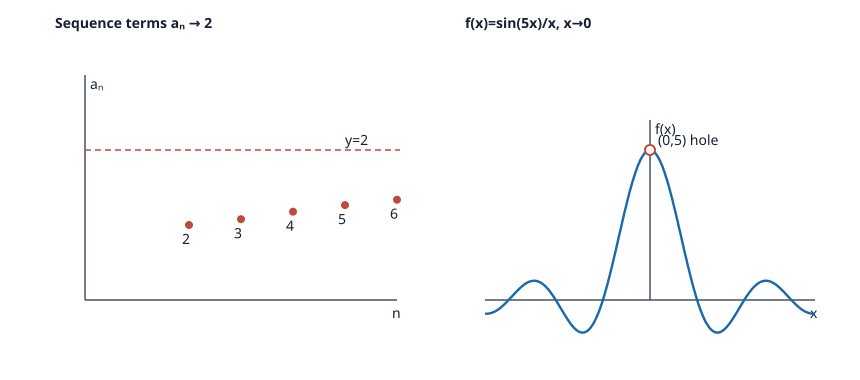

# Problem 15: Observation Versus Proof

## 1. Original Problem
Choose one sequence and one function from this set. For the sequence, compute several values for increasingly large $n$. For the function, prepare a table of values with arguments approaching the limit point from the left and right. Sketch the behavior of both objects.

Compare the observation with the analytical result and explain why a finite number of calculations or a sketch does not constitute a proof that the limit exists.

## 2. What We Are Trying to Find
We must:
1. Select one sequence from this chapter (we choose $a_n = \frac{4n^2-3n+1}{2n^2+5n-7}$ from Exercise 1) and calculate concrete numerical values for growing $n$.
2. Select one function from this chapter (we choose $f(x) = \frac{\sin 5x}{x}$ from Exercise 13) and build a two-sided numerical table approaching $x = 0$ from the left and right.
3. Describe the qualitative graphical sketches of both objects.
4. Compare empirical observations with formal analytical proofs.
5. Provide a rigorous mathematical explanation of why finite tables of values and graphical drawings never constitute a valid mathematical proof.

## 3. Key Idea or Theorem Needed Before the Calculation
- **Role of Empirical Calculation**:
  Computing numerical values and sketching graphs generates mathematical intuition and helps form conjectures.
- **Formal Definition of a Limit ($\epsilon$-$N$ and $\epsilon$-$\delta$)**:
  - Sequence limit: $\forall \epsilon > 0, \exists N \in \mathbb{N}$ such that $\forall n > N, |a_n - L| < \epsilon$.
  - Function limit: $\forall \epsilon > 0, \exists \delta > 0$ such that $\forall x$ with $0 < |x - c| < \delta$, $|f(x) - L| < \epsilon$.
- **Universal Quantifier $\forall$**:
  The definition requires that the condition holds for **all** infinitely many indices $n > N$ and for **all** real numbers in a continuum $(c-\delta, c+\delta) \setminus \{c\}$. A finite sample size $k$ cannot verify a universal statement over an infinite domain.

## 4. Step-by-Step Solution

### Step 1: Numerical analysis of the sequence $a_n = \frac{4n^2-3n+1}{2n^2+5n-7}$
Analytically, we proved in Exercise 1 that $\lim_{n \to \infty} a_n = 2$.
Let us calculate terms for increasing $n$:
- $n = 1$: $a_1 = \frac{4(1) - 3 + 1}{2(1) + 5 - 7} = \frac{2}{0}$ (undefined; sequence starts at $n=2$).
- $n = 2$: $a_2 = \frac{4(4) - 6 + 1}{2(4) + 10 - 7} = \frac{11}{11} = 1.000000$.
- $n = 5$: $a_5 = \frac{100 - 15 + 1}{50 + 25 - 7} = \frac{86}{68} \approx 1.264706$.
- $n = 10$: $a_{10} = \frac{400 - 30 + 1}{200 + 50 - 7} = \frac{371}{243} \approx 1.526749$.
- $n = 50$: $a_{50} = \frac{10000 - 150 + 1}{5000 + 250 - 7} = \frac{9851}{5243} \approx 1.878886$.
- $n = 100$: $a_{100} = \frac{40000 - 300 + 1}{20000 + 500 - 7} = \frac{39701}{20493} \approx 1.937296$.
- $n = 1{,}000$: $a_{1000} = \frac{3997001}{2004993} \approx 1.993524$.
- $n = 10{,}000$: $a_{10000} \approx 1.999350$.

**Observation**: The terms form a sequence of discrete dots strictly climbing toward the horizontal line $y = 2$.

---

### Step 2: Numerical analysis of the function $f(x) = \frac{\sin 5x}{x}$ as $x \to 0$
Analytically, we proved in Exercise 13 that $\lim_{x \to 0} f(x) = 5$.
At $x = 0$, $f(0) = \frac{0}{0}$ is undefined. Let us evaluate approaching from both sides:

| $x$ (left approach) | $f(x) = \frac{\sin 5x}{x}$ | $x$ (right approach) | $f(x) = \frac{\sin 5x}{x}$ |
| :--- | :--- | :--- | :--- |
| $-0.1$ | $\frac{\sin(-0.5)}{-0.1} \approx 4.794255$ | $+0.1$ | $\frac{\sin(0.5)}{0.1} \approx 4.794255$ |
| $-0.05$ | $\frac{\sin(-0.25)}{-0.05} \approx 4.948079$ | $+0.05$ | $\frac{\sin(0.25)}{0.05} \approx 4.948079$ |
| $-0.01$ | $\frac{\sin(-0.05)}{-0.01} \approx 4.997917$ | $+0.01$ | $\frac{\sin(0.05)}{0.01} \approx 4.997917$ |
| $-0.001$ | $\frac{\sin(-0.005)}{-0.001} \approx 4.999979$ | $+0.001$ | $\frac{\sin(0.005)}{0.001} \approx 4.999979$ |

**Observation**: As $|x| \to 0$, $f(x)$ symmetrically approaches $5.000000$ from below.
**Sketch**: The sampled function is even and has a removable hole at $(0,5)$.

---

### Step 3: Why finite calculations and sketches do not constitute a proof

#### Reason 1: The gap between finite samples and infinity
A table calculates $f(x)$ for 5 or 10 specific numbers. However, between any two real numbers, there are infinitely many points.
- *Counterexample*: Let $g(x) = \frac{\sin 5x}{x} + \sin\left(\frac{\pi}{x}\right)$.
  At every nonzero sample argument in the table, $1/x$ is an integer, so the added term is zero and the tabulated values are unchanged. But along $x_n=1/(2n+1/2)$, the added sine equals $1$, while along $y_n=1/(2n+3/2)$ it equals $-1$. Both sequences approach zero, and $\sin(5x)/x\to5$, so $g(x_n)\to6$ and $g(y_n)\to4$. The two paths give different limits, proving that $g$ has no limit at zero.

#### Reason 2: Misleading visual sketches
Drawings have finite physical resolution (pen width, pixels).
- A sketch cannot show an infinitesimal removable discontinuity or determine whether a curve levels off at $y = 2.00000$ or $y = 1.99999$.
- *Counterexample*: The sequence $s_n = 2 - \frac{1}{n} + \frac{(-1)^n}{10^8}$ visually looks identical to a smooth convergence to $2$, but it actually oscillates forever and never converges.

#### Reason 3: Epistemology of mathematical proof
Mathematical proof requires deductive reasoning establishing that $|a_n - L| < \epsilon$ holds **for every possible $\epsilon > 0$**, no matter how microscopic ($10^{-100}$ or smaller). An empirical table merely shows that a pattern holds for a handful of convenient test points. Only algebraic theorems (like limit laws, Squeeze Theorem, and continuity) establish universal truth across all infinite cases.

## 5. Why Each Step Is Valid
1. **Radian mode evaluation**: The derivative and limit properties of trigonometric functions require radian arguments; calculating table values in radians accurately reflects the mathematical function.
2. **Even function symmetry**: Because $\sin(-u) = -\sin(u)$, $f(-x) = \frac{\sin(-5x)}{-x} = \frac{-\sin 5x}{-x} = f(x)$, justifying identical values from the left and right.
3. **Universal quantification**: By definition of mathematical logic, verifying $P(x)$ for a finite subset $S \subset D$ never proves $\forall x \in D, P(x)$ when $D$ is infinite.

## 6. Final Answer in Words
Computing values for $a_n = \frac{4n^2-3n+1}{2n^2+5n-7}$ shows growth toward $2$, and the table for $f(x) = \frac{\sin 5x}{x}$ shows values approaching $5$ from both sides. A finite table or sketch is not a proof: the added term $\sin(\pi/x)$ vanishes at every nonzero sample point in our table, while the sequences $1/(2n+1/2)$ and $1/(2n+3/2)$ make it approach opposite values. Only an argument covering all sufficiently large $n$ or all $x$ sufficiently close to zero proves a limit.

## 7. Quick Verification
- For the sequence: at $n = 10^5$, $a_{100000} = 1.999935$, confirming continued approach to $2$.
- For the function: at $x = 10^{-5}$, $f(10^{-5}) = 4.999999998$, confirming approach to $5$.
- Analytical certainty: $a_n - 2 = \frac{4n^2-3n+1 - 2(2n^2+5n-7)}{2n^2+5n-7} = \frac{-13n + 15}{2n^2+5n-7} \sim -\frac{13}{2n} \to 0$. This deductive formula proves convergence for all $n$, whereas a table only checks specific examples.

## 8. Common Mistakes
- **Assuming that a table constitutes a proof**: Thinking that showing 5 decimal approximations suffices to prove a limit in a mathematics exam.
- **Overlooking one-sided behavior**: Testing only positive $x$ values and assuming the left side behaves identically, which fails for functions like $\frac{1}{x-2}$ (Exercise 9).
- **Using a rough sketch to deduce asymptotic limits**: Relying on visual curves that can hide slow divergence (e.g., $\ln x$ looks flat but grows to $\infty$).

## 9. Short In-Class Explanation (3 Sentences)
Calculating numerical tables for $\frac{4n^2-3n+1}{2n^2+5n-7}$ shows growth toward $2$, while the table for $\frac{\sin 5x}{x}$ approaches $5$ from both sides. A finite table or sketch is not a proof: adding $\sin(\pi/x)$ leaves every listed nonzero sample value unchanged, but along $x_n=1/(2n+1/2)$ and $y_n=1/(2n+3/2)$ the added term tends to opposite values. A proof must cover all sufficiently large $n$ or all $x$ sufficiently close to zero.
