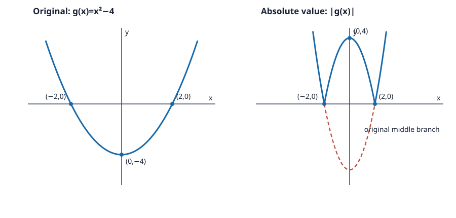

# Problem 12: A Function with an Absolute Value

## 1. Original Problem
Analyze $f(x)=|x^2-4|$: describe the absolute value, identify where the derivative fails, and explain geometrically.

## 2. What We Are Trying to Find
We determine where the expression inside the absolute value is positive or negative, rewrite the function piecewise, and compare slopes at the joins.

## 3. Key Idea or Theorem Needed Before the Calculation
Absolute value leaves nonnegative values unchanged and reflects negative values across the $x$-axis. At join points, differentiability requires matching one-sided slopes.

## 4. Step-by-Step Solution
The expression $x^2-4$ is nonnegative when $|x|\ge2$ and negative when $|x|<2$. Therefore
$$f(x)=\begin{cases}x^2-4,&x\le-2\text{ or }x\ge2,\\4-x^2,&-2<x<2.\end{cases}$$
For the outer pieces, $f'=2x$; for the middle piece, $f'=-2x$. At $x=-2$, left slope is $-4$ and right slope is $4$. At $x=2$, left slope is $-4$ and right slope is $4$. Since these differ, the derivative does not exist at either point. The graph is even, has zeros at $\pm2$, and a central maximum $f(0)=4$. First sketch $g(x)=x^2-4$, whose vertex is $(0,-4)$ and whose zeros are $(-2,0)$ and $(2,0)$. Then reflect only the part of $g$ below the x-axis, where $-2<x<2$, across that axis; leave the outer branches unchanged.

## 5. Why Each Step Is Valid
The piecewise expression follows the sign of the inside. Different one-sided slopes mean no single tangent slope can represent the graph at each corner.

## 6. Final Answer in Words
The graph is a central downward arch from $(-2,0)$ to $(2,0)$ joined to upward-opening outer branches. It is nondifferentiable at $x=\pm2$.

## 7. Quick Verification
For $x=0$, original formula gives $|-4|=4$, matching the middle formula. For $x=3$, it gives 5, matching $x^2-4$.

## 8. Common Mistakes
- Leaving the inside negative on $(-2,2)$ instead of reflecting it.
- Saying the derivative is zero at the corner because the graph touches the axis.

## 9. Short In-Class Explanation
The middle part of $x^2-4$ lies below the axis, so absolute value flips it up. The resulting graph has sharp corners at $x=\pm2$, where left and right slopes disagree.

The two panels show the original parabola first and the absolute-value graph second. In the second panel, the dashed curve is the original negative middle portion; the solid arch is its reflection above the x-axis. The zeros remain on the axis, and the reflected vertex is $(0,4)$.

