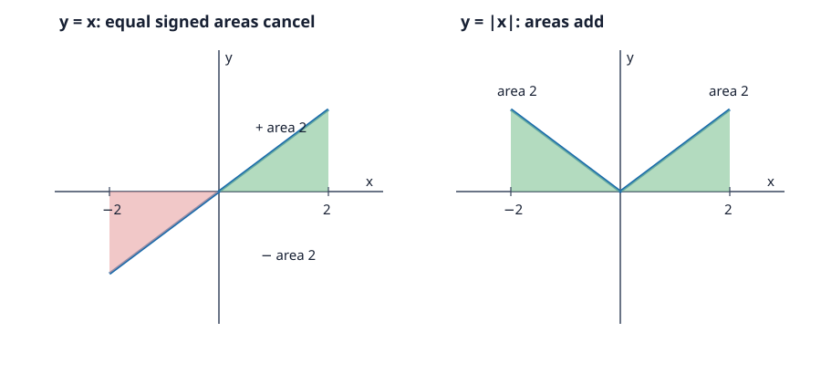

# Problem 12: Symmetry, Sign, and Absolute Value

## 1. Original Problem
Compare $\int_{-2}^2x\,dx$ and $\int_{-2}^2|x|\,dx$. Before calculating, predict the results from symmetry and a sketch, then calculate and explain the difference.

## 2. What We Are Trying to Find
We compare signed accumulation for the odd function $y=x$ with total positive accumulation for $y=|x|$. The sketch helps predict whether the two halves cancel or add.

## 3. Key Idea or Theorem Needed Before the Calculation
An odd function has opposite values at opposite inputs, so its integral on symmetric bounds is zero. The absolute value reflects negative function values above the horizontal axis. The graph of $|x|$ is even, and its two equal triangular regions add.

## 4. Step-by-Step Solution

### Sketch and Prediction Before Calculation
For $y=x$ on $[-2,0]$, the triangular region is below the axis; on $[0,2]$, an equal triangular region is above. Their signed contributions should cancel, predicting 0. For $y=|x|$, the left triangle is reflected above the axis, so both areas should add, predicting 4.

### Calculation
The function $x$ is odd, so opposite inputs cancel. Direct evaluation confirms the prediction:
$$\int_{-2}^2x\,dx=\left[\frac{x^2}{2}\right]_{-2}^2=2-2=0.$$

The absolute value is even, so double the integral over the positive half:
$$\int_{-2}^2|x|\,dx=2\int_0^2x\,dx=2\left[\frac{x^2}{2}\right]_0^2=4.$$
Each triangle has base 2 and height 2, so its area is $\frac12(2)(2)=2$. The signed areas cancel for $y=x$, while the two positive areas add for $y=|x|$.

## 5. Why Each Step Is Valid
Symmetry pairs $x$ with $-x$. For $y=x$ their heights have opposite signs; for $y=|x|$ both heights are nonnegative and equal in magnitude. The antiderivative calculation agrees with that geometric reasoning.

## 6. Final Answer in Words
$$\int_{-2}^2x\,dx=0,\qquad \int_{-2}^2|x|\,dx=4.$$
The first result is cancellation of signed areas; the second is the sum of the two triangular areas.

## 7. Quick Verification
On $[0,2]$, $\int_0^2x\,dx=2$. The negative half contributes $-2$ to the first integral and $+2$ after taking absolute value. This gives 0 and 4, respectively.

## 8. Common Mistakes
- Claiming both integrals are zero merely because the bounds are symmetric; the absolute-value function is even, not odd.
- Confusing signed integral with total geometric area.
- Omitting the left-hand triangle after reflecting it above the axis.

## 9. Short In-Class Explanation
The graph of $y=x$ has equal triangles below and above the axis on $[-2,2]$, so their signed areas cancel to zero. For $y=|x|$, the left triangle reflects upward and both areas add. Each triangle has area 2, so that integral is 4.