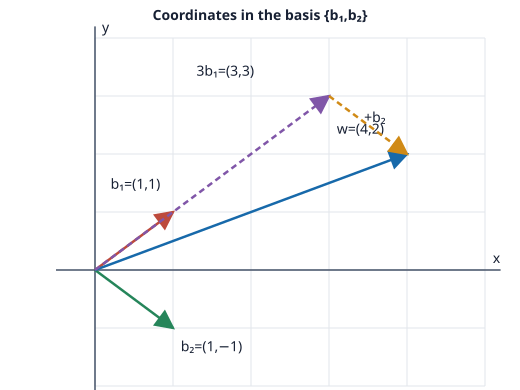

# Problem 2: Coordinates in a Basis

## Problem

In $\mathbb R^2$, let $b_1=(1,1)$ and $b_2=(1,-1)$. Show that they form a basis and find the coordinates of $w=(4,2)$ in this basis.

## Worked Solution

Place the vectors as the columns of a matrix. Its determinant is
$$\det\begin{pmatrix}1&1\\1&-1\end{pmatrix}=-1-1=-2\ne0.$$
The columns are therefore linearly independent. Since two independent vectors in $\mathbb R^2$ form a basis, $\{b_1,b_2\}$ is a basis.

To find the coordinates, write $w=\alpha b_1+\beta b_2$. Comparing components gives
$$\alpha(1,1)+\beta(1,-1)=(\alpha+\beta,\alpha-\beta)=(4,2).$$
Thus $\alpha+\beta=4$ and $\alpha-\beta=2$. Adding these equations yields $2\alpha=6$, so $\alpha=3$ and $\beta=1$. Hence
$$[w]_{\{b_1,b_2\}}=\boxed{(3,1)},\qquad w=3b_1+b_2.$$

The diagram shows this reconstruction: $3b_1=(3,3)$ and $b_2=(1,-1)$ add to $(4,2)$.

**Check.** $3(1,1)+(1,-1)=(4,2)$, which is the given vector $w$.
