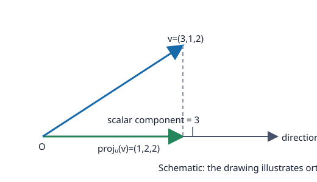

# Problem 4: Scalar Component and Vector Projection

## Problem

Find the scalar component and vector projection of $v=(3,1,2)$ onto the directed axis with direction $u=(1,2,2)$.

## Worked Solution

The direction vector has norm $\|u\|=\sqrt{1+4+4}=3$, and the dot product is
$$v\cdot u=3\cdot1+1\cdot2+2\cdot2=9.$$
The scalar component along the directed axis is the signed projection
$$\operatorname{comp}_u(v)=\frac{v\cdot u}{\|u\|}=\frac93=\boxed{3}.$$
The vector projection points along $u$ and has this scalar component as its signed length:
$$\operatorname{proj}_u(v)=\frac{v\cdot u}{\|u\|^2}u=\frac99(1,2,2)=\boxed{(1,2,2)}.$$

**Check.** The projection is parallel to $u$, and the residual $v-\operatorname{proj}_u(v)=(2,-1,0)$ is perpendicular to $u$, since $(2,-1,0)\cdot(1,2,2)=0$.
