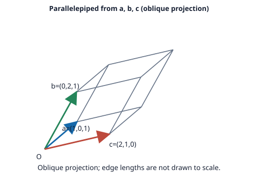

# Problem 8: Parallelepiped Volume and Signed Triple Product

## Problem

Find the volume of the parallelepiped spanned by $a=(1,0,1)$, $b=(0,2,1)$, and $c=(2,1,0)$. Also give the signed scalar triple product.

## Worked Solution

The signed scalar triple product, in the stated order, is $a\cdot(b\times c)$. First,
$$b\times c=(2\cdot0-1\cdot1,\ 1\cdot2-0\cdot0,\ 0\cdot1-2\cdot2)=(-1,2,-4).$$
Then
$$a\cdot(b\times c)=(1,0,1)\cdot(-1,2,-4)=-1-4=\boxed{-5}.$$
The negative sign indicates orientation. Geometric volume is the absolute value:
$$V=|a\cdot(b\times c)|=\boxed{5}.$$

**Check.** The scalar triple product is nonzero, so the three vectors are not coplanar and span a nonzero volume.
