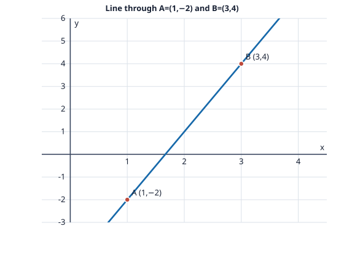

# Problem 1: Equation Through Two Points

## Problem

Find the slope of the line through $A=(1,-2)$ and $B=(3,4)$. Determine its general equation and slope-intercept equation. Draw the line through the two given points on coordinate axes.

## Worked Solution

The slope between two points is the change in $y$ divided by the change in $x$:
$$m=\frac{4-(-2)}{3-1}=\frac62=3.$$
Use $y=mx+b$ and substitute $A=(1,-2)$ to find the intercept: $-2=3(1)+b$, so $b=-5$. The slope-intercept equation is
$$\boxed{y=3x-5}.$$
Moving every term to the left gives the general form
$$\boxed{3x-y-5=0}.$$

**Check.** At $x=1$, the equation gives $y=-2$; at $x=3$, it gives $y=4$. Both points lie on the line.
