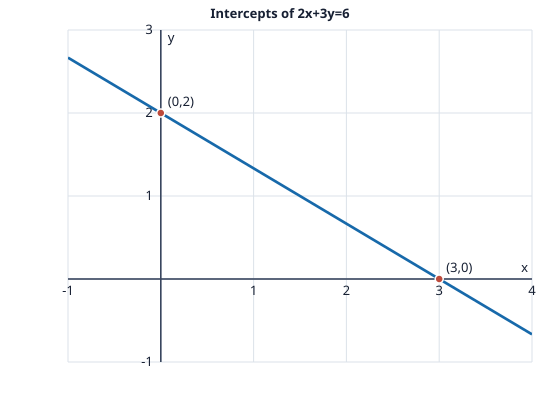

# Problem 2: Intercepts and Forms of a Line

## Problem

For the line $2x+3y=6$, calculate both axis intercepts. Write the equation in intercept form and slope-intercept form. Sketch the line using the intercepts.

## Worked Solution

At the $x$-intercept, set $y=0$: $2x=6$, so the point is $(3,0)$. At the $y$-intercept, set $x=0$: $3y=6$, so the point is $(0,2)$.

The intercept form is $x/a+y/b=1$, where $a$ and $b$ are the $x$- and $y$-intercepts. Thus
$$\boxed{\frac{x}{3}+\frac{y}{2}=1}.$$
Solving the original equation for $y$ gives
$$3y=6-2x\quad\Longrightarrow\quad\boxed{y=-\frac23x+2}.$$

**Check.** Both intercept points satisfy $2x+3y=6$, and the slope-intercept form gives the same intercepts.
