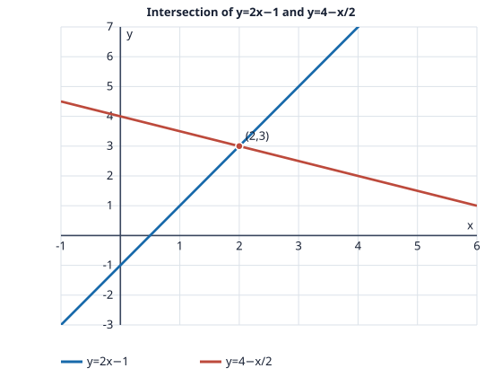

# Problem 6: Intersection and Graph of Two Lines

## Problem

Find the intersection of $2x-y=1$ and $x+2y=8$ by solving the system. Rewrite both lines in slope-intercept form and sketch them on one coordinate plane, marking their intersection.

## Worked Solution

Rewrite each equation to isolate $y$:
$$2x-y=1\quad\Longrightarrow\quad y=2x-1,$$
$$x+2y=8\quad\Longrightarrow\quad y=4-\frac12x.$$
At the intersection the two expressions for $y$ are equal:
$$2x-1=4-\frac12x\quad\Longrightarrow\quad\frac52x=5\quad\Longrightarrow\quad x=2.$$
Substitution gives $y=2(2)-1=3$.

**Answer and check:** $\boxed{(2,3)}$. It satisfies $2(2)-3=1$ and $2+2(3)=8$.
