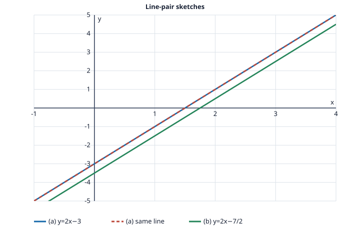

# Problem 8: Coincident and Parallel Lines

## Problem

For each pair, rewrite both equations in slope-intercept form, decide whether the lines coincide, are parallel, or intersect at one point, and give the number of intersection points. Make a simple sketch of each pair.

**(a)** $2x-y=3$ and $4x-2y=6$.

**(b)** $2x-y=3$ and $4x-2y=7$.

## Worked Solution

### (a)

Solving for $y$ gives $y=2x-3$ for the first line. Dividing the second equation by $2$ gives the same equation, $2x-y=3$, or $y=2x-3$. The two equations describe one coincident line, so there are infinitely many intersection points.

### (b)

The first line is $y=2x-3$. Dividing the second equation by $2$ gives $2x-y=7/2$, or $y=2x-7/2$. The slopes are both $2$ but the intercepts differ, so the lines are parallel and distinct. There are no intersection points.

**Check.** Coincident equations are scalar multiples in (a). In (b), the equal slopes and unequal intercepts rule out an intersection.
