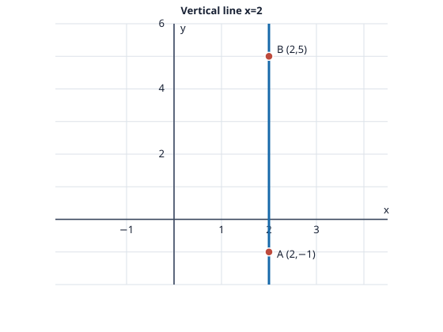

# Problem 9: A Vertical Line

## Problem

The line through $A=(2,-1)$ and $B=(2,5)$ is vertical. Find its general and parametric equations. Explain why it cannot be written as $y=mx+b$, and sketch it on coordinate axes.

## Worked Solution

Both points have $x=2$, so every point on the line has this same $x$-coordinate. Its general equation is
$$\boxed{x-2=0}.$$
A direction vector from $A$ to $B$ is $(0,6)$; using the simpler parallel direction $(0,1)$, a parametric equation is
$$\boxed{(x,y)=(2,-1)+t(0,1)},\quad\text{that is }x=2,\ y=-1+t,\quad t\in\mathbb R.$$

A slope-intercept equation $y=mx+b$ assigns one $y$-value to each $x$-value. On this vertical line, the fixed value $x=2$ corresponds to infinitely many $y$-values, so no finite slope $m$ can describe it.

**Check.** For $t=0$ the parametric form gives $A=(2,-1)$, and for $t=6$ it gives $B=(2,5)$.
