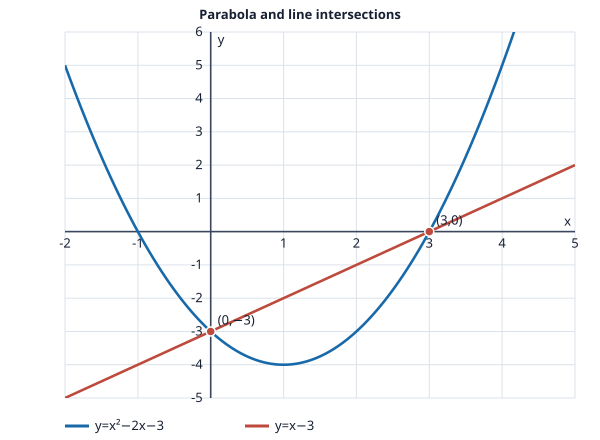

# Problem 8: Intersections of a Parabola and a Line

## Problem

Find the intersection points of $y=x^2-2x-3$ and $y=x-3$. Show how the equations lead to a quadratic equation, solve it, and sketch both curves on the same coordinate axes, marking the intersections.

## Worked Solution

At an intersection, the two expressions for $y$ are equal:
$$x^2-2x-3=x-3.$$
Moving everything to one side gives the quadratic
$$x^2-3x=0\quad\Longrightarrow\quad x(x-3)=0.$$
Therefore $x=0$ or $x=3$. The line equation $y=x-3$ gives $y=-3$ when $x=0$ and $y=0$ when $x=3$.

The intersection points are $\boxed{(0,-3)}$ and $\boxed{(3,0)}$.

**Check.** The parabola also gives $-3$ at $x=0$ and $0$ at $x=3$, matching the line at both points.
