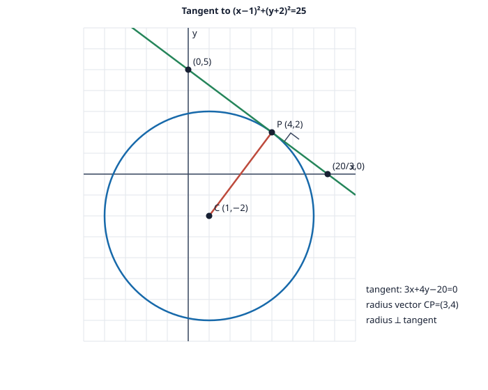

# Problem 9: Tangent to a Circle

## Problem

Consider the circle $(x-1)^2+(y+2)^2=25$ and the point $P=(4,2)$. Verify that $P$ lies on the circle and determine its centre. Find the vector from the centre to $P$, then use the fact that the tangent is perpendicular to this radius to derive the tangent-line equation in the form $Ax+By+C=0$. Calculate where the tangent intersects each coordinate axis.

## Worked Solution

The circle is in canonical form, so its centre is $C=(1,-2)$ and its radius is $5$. At $P=(4,2)$,
$$ (4-1)^2+(2+2)^2=3^2+4^2=25,$$
so $P$ lies on the circle. The radius vector from the centre to $P$ is
$$\overrightarrow{CP}=(4-1,2-(-2))=(3,4).$$
This is a normal vector to the tangent at $P$. Therefore a point $(x,y)$ on the tangent satisfies
$$ (3,4)\cdot((x,y)-(4,2))=0,$$
which gives
$$3(x-4)+4(y-2)=0\quad\Longrightarrow\quad\boxed{3x+4y-20=0}.$$
At the $x$-axis set $y=0$, giving $x=20/3$. At the $y$-axis set $x=0$, giving $y=5$.

**Answer:** tangent intercepts $\boxed{(20/3,0)}$ and $\boxed{(0,5)}$.

**Check.** The tangent contains $P$ because $3(4)+4(2)-20=0$. Its direction vector $(4,-3)$ is perpendicular to the radius $(3,4)$ because $3(4)+4(-3)=0$.
