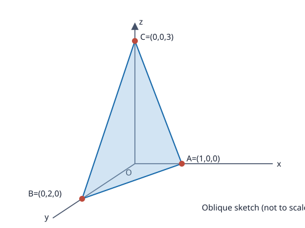

# Problem 2: Plane Through Three Axis Intercepts

## Problem

Find the plane through $A=(1,0,0)$, $B=(0,2,0)$, and $C=(0,0,3)$. Give general and intercept forms.

## Worked Solution

The points are the plane's intercepts on the $x$-, $y$-, and $z$-axes: $1$, $2$, and $3$. The intercept form is therefore
$$\boxed{\frac{x}{1}+\frac{y}{2}+\frac{z}{3}=1}.$$
Multiplying by $6$ and moving all terms to the left gives the general form
$$\boxed{6x+3y+2z-6=0}.$$

**Check.** Substituting $A$, $B$, and $C$ into the general equation gives $6-6=0$, $6-6=0$, and $6-6=0$, respectively.
