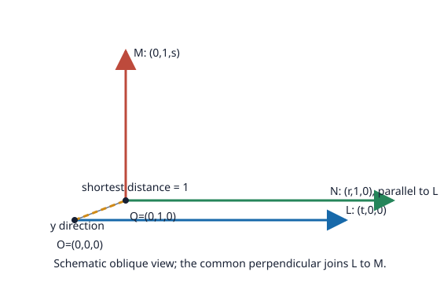

# Problem 8: Relative Position and Distance of Lines

## Problem

Classify the relative position of
$$L:(x,y,z)=(t,0,0),\qquad M:(x,y,z)=(0,1,s).$$
Are they parallel, intersecting, or skew? Find their shortest distance. Also classify
$$N:(x,y,z)=(0,1,0)+r(1,0,0)$$
relative to $L$.

## Worked Solution

The direction vectors are $d_L=(1,0,0)$ and $d_M=(0,0,1)$, which are not parallel. A point of $L$ always has $y=0$, while a point of $M$ always has $y=1$, so the lines cannot intersect. Nonparallel and nonintersecting lines in space are skew.

For the shortest distance between skew lines, use
$$d(L,M)=\frac{|(Q-P)\cdot(d_L\times d_M)|}{\|d_L\times d_M\|},$$
where $P=(0,0,0)\in L$ and $Q=(0,1,0)\in M$. Here $d_L\times d_M=(0,-1,0)$, so
$$d(L,M)=\frac{|(0,1,0)\cdot(0,-1,0)|}{1}=\boxed1.$$

The line $N$ has the same direction as $L$, but its points have $y=1$ instead of $y=0$. Hence $N$ and $L$ are distinct parallel lines.

**Check.** The common perpendicular points in the $y$-direction, connecting $(0,0,0)$ to $(0,1,0)$, and has length $1$.
